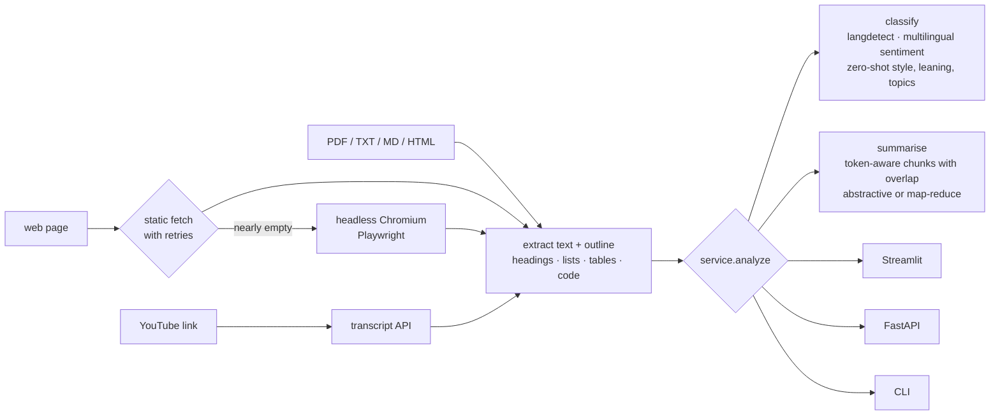

# Text Classifier & Summarizer


Drop in a **PDF, a text or HTML file, a web page (even a JavaScript-heavy one) or a YouTube link**, and get back:

- the **language**,
- **sentiment** from a multilingual model,
- **writing style** (formal or informal),
- the main **topics**,
- an experimental **political-leaning** signal,
- a **summary** (abstractive, or map-reduce for long documents),
- the document's **outline** including title, headings, pages and tables.

It runs as a Streamlit app, a FastAPI service or a CLI. All three share one tested core, so they always behave the same.

---

## Why I built it

A lot of my work is NLP that has to survive contact with real content. That is, messy web pages, scanned PDFs, transcripts, documents in more than one language. This project bundles the first questions I ask about any document, *what is it, how does it feel, what is it about, and what does it say*, behind a clean interface that is honest about its limits.

## How it works



Every interface calls one function, `service.analyze(request)`. It returns the textstatistics, the source outline, the classification, the summary and per-stage timings.

## Quick start

```bash
git clone https://github.com/mwi-kali/Text-Classifier.git
cd Text-Classifier
python -m venv .venv && source .venv/bin/activate
pip install -e ".[models,ui,api,dev]" --extra-index-url https://download.pytorch.org/whl/cpu
pip install -e ".[browser]" && python -m playwright install chromium
```

```bash
streamlit run text_classifier/app.py                              
text-classifier analyze report.pdf                                
text-classifier analyze https://youtu.be/<id> --map-reduce
text-classifier analyze https://example.com/spa --render-js      
text-classifier serve                                             
pytest                                                            
```

The first request downloads the models (about 3 GB). `POST /warmup` loads them ahead of traffic, and `docker run -v hf-cache:/models` keeps them between container restarts.

`make` shortcuts: `make install`, `make test`, `make test-models`, `make evaluate`, `make ui`, `make api`, `make docker-run`.

## Interfaces

### Streamlit UI

- Pick a source in the sidebar: **File**, **URL** or **Text**. Forget, and the app gently reminds you: *"Btw... it is in the sidebar."* 👈
- Toggle classification and summarisation, and choose the abstractive or map-reduce mode.
- Results show as metric cards: sentiment (colour-coded with confidence), language, style, political leaning and topic badges.
- A **document outline** expander lists the detected headings, plus page and table counts, and notes when the page had to be rendered in a browser.
- Download the summary as a `.txt` file.

### CLI

| Command | Options |
|---|---|
| `text-classifier analyze <file-or-url>` or `--text "…"` | `--no-classify`, `--no-summary`, `--map-reduce`, `--render-js`, `--no-tables`, `--no-lists`, `--no-code`, `--chunk-tokens`, `--overlap-tokens`, `--batch-size` |
| `text-classifier evaluate` | `--corpus eval/corpus.jsonl`, `--report-dir reports` |
| `text-classifier serve` | `--host`, `--port` |

### REST API

| Method & path | Body | Notes |
|---|---|---|
| `GET /health` | | Answers instantly, even before models load. Lists the configured models and how many are loaded |
| `POST /warmup` | | Loads all models |
| `POST /analyze` | `{"text": "…"}` **or** `{"url": "…"}`, plus options below | Exactly one source, or a 422 |
| `POST /analyze/file` | multipart `file`, query `summarize`, `classify` | PDF, TXT, MD, HTML |

`/analyze` options: `classify`, `summarize`, `summary_mode` (`abstractive` or `map-reduce`),
`topics` (your own candidate labels), `render_js` (`null` = auto), `include_tables`,
`include_lists`, `include_code`, `max_chars` (extraction depth).

```bash
curl -s localhost:8000/analyze -H 'content-type: application/json' \
  -d '{"url": "https://en.wikipedia.org/wiki/Nairobi", "summary_mode": "map-reduce", "topics": ["technology", "history", "transport"]}'
```

Response shape (values illustrative):

```json
{
  "characters": 48211, "words": 7560,
  "source": {"source_type": "html", "title": "Nairobi - Wikipedia", "headings": ["History", "Geography", "..."], "tables": 6, "rendered_js": false},
  "classification": {"language": "en", "sentiment": {"label": "neutral", "score": 0.71},"style": {"label": "formal", "score": 0.93}, "political": {"label": "centrist", "score": 0.41}, "topics": [{"label": "history", "score": 0.88}, {"label": "transport", "score": 0.64}]},
  "summary": "Nairobi is the capital and largest city of Kenya …",
  "timings_ms": {"ingest": 812.4, "classify": 1430.2, "summarize": 9120.7}
}
```

## Ingestion in detail

| Source | How | Robustness |
|---|---|---|
| PDF | `pypdf`, page by page | Corrupt files and scanned PDFs (no text layer) get clear messages |
| TXT / MD | UTF-8 (with BOM), UTF-16 only when a BOM says so, else Windows-1252 | No garbled text from guessing the wrong encoding |
| HTML files and web pages | BeautifulSoup: title, headings, paragraphs, **lists**, **tables** (rows as `a \| b \| c`), **code blocks**, quotes, captions; navigation, ads, forms and footers removed; duplicates dropped | Retries with exponential back-off on connection errors, 429 and 5xx; separate connect/read timeouts; 10 MB cap |
| JavaScript-rendered pages | Playwright headless Chromium (`browser` extra) | **Auto mode**: used only when the static HTML yields almost no text; `--render-js` forces it |
| PDFs linked by URL | Detected by content type | |
| YouTube | `youtube-transcript-api` | Videos without transcripts get a friendly error |

Every source returns the same structure: text plus `title`, `headings` (one section per heading), `pages`, `tables`, `rendered_js` and `words`. `ExtractionOptions` controls which tags are kept, the minimum block length, and the extraction depth.

## Classification in detail

| Signal | Model | Notes |
|---|---|---|
| Language | `langdetect` with a fixed seed | Deterministic results |
| Sentiment | `tabularisai/multilingual-sentiment-analysis` | Five levels from *very negative* to *very positive*, many languages |
| Style | zero-shot `facebook/bart-large-mnli` | formal / informal |
| Political leaning | zero-shot | left-leaning / centrist / right-leaning. **Experimental**, and labelled as such in the UI |
| Topics | zero-shot, multi-label | Candidates = frequent content words from the text plus a default list, or your own `topics` |

Classification looks at the opening ~350 words, which is where most documents state what they are about.

## Summarisation in detail

- **Token-aware chunking.** Text is packed sentence by sentence up to 700 tokens, measured with BART's own tokenizer, the model that does the summarising. Consecutive chunks share 60 tokens of overlap, so ideas that straddle a boundary keep their context.
- **Batching.** Chunks go through the model 4 at a time and come back **in document order**.
- **Length bounds scale with each chunk**, so the model is never asked to write a summary longer than its input.
- **Map-reduce** summarises the chunks, then *incrementally* packs and re-summarises the partial summaries until they fit in one chunk (at most 3 rounds), instead of concatenating everything into one oversized input.
- Text under 40 words is returned unchanged; it is already a summary.

## Measuring summary quality

```bash
text-classifier evaluate         
```

For each document in `eval/corpus.jsonl` (three short articles with reference summaries), and for both modes, the evaluation reports:

| Metric | Meaning |
|---|---|
| ROUGE-L F1 | Longest-common-subsequence overlap with the reference |
| Compression | Summary words ÷ source words |
| Flesch reading ease | Higher reads more easily; a cheap readability proxy |
| Latency, peak memory | Seconds and MB per summary |
| Forward passes | How many model calls the mode needed |

CI runs it with real (smaller) models and publishes the table on the workflow summary page.
ROUGE-L is implemented in plain Python here, so evaluation adds no dependencies.

## Configuration

| Variable | Default | |
|---|---|---|
| `TC_SENTIMENT_MODEL` | `tabularisai/multilingual-sentiment-analysis` | Any text-classification checkpoint |
| `TC_ZERO_SHOT_MODEL` | `facebook/bart-large-mnli` | CI uses `typeform/distilbert-base-uncased-mnli` |
| `TC_SUMMARY_MODEL` | `sshleifer/distilbart-cnn-12-6` | CI tests this same model (the quality gate is calibrated for it) |
| `TC_SUMMARY_CHUNK_TOKENS` | `700` | BART accepts 1,024 |
| `TC_SUMMARY_OVERLAP_TOKENS` | `60` | Context carried across chunks |
| `TC_SUMMARY_BATCH_SIZE` | `4` | Chunks per forward pass |

Limits in `text_classifier/config.py`: 10 MB downloads, 400,000 characters of input, 15 s HTTP timeout.

## Testing and CI

```bash
pytest                    
pytest -m models          
pytest -m browser        
```

- **Dependency injection** so that the `Classifier` and `Summarizer` take their pipelines as arguments, so tests pass fakes that record what they were called with. That is how the tests prove summaries keep document order and chunks respect token budgets.
- **Loader tests** for every path including PDF (page counts, blank scans, corrupt and mislabelled files), TXT encodings, HTML structure (lists, tables, code, headings→sections, extraction flags, div-only pages), web pages by content type, oversized downloads, friendly network errors, malformed URLs, retry and timeout configuration, the JS-render fallback (plus a real headless render when Chromium is installed), and YouTube with and without transcripts.
- **Edge cases** including empty input, malformed URLs, unsupported files, and very large texts (~14k words) through map-reduce.
- **API and CLI** tests through FastAPI's `TestClient` and the real argument parser.

GitHub Actions: ruff and the test suite on Python 3.11 and 3.12 (Chromium installed for the browser tests); a real-model smoke job with the summary-quality report; a Docker build with a health probe.

## Deployment

```bash
make docker-run   
```

The multi-stage, non-root image uses CPU-only PyTorch. `/health` answers before the models load, so orchestrators don't kill the container during start-up. Models download on first use (or on `/warmup`) into the `/models` volume.

## Project layout

```
.
├── text_classifier/
│   ├── ingestion.py      files, web pages (static + headless browser), PDFs by URL, YouTube
│   ├── utils.py          Unicode-safe cleaning, URL helpers, candidate topics
│   ├── models.py         lazy, cached, thread-safe Hugging Face pipelines
│   ├── classification.py language, sentiment, style, leaning, topics
│   ├── summarization.py  token-aware chunking with overlap, batching, map-reduce
│   ├── evaluation.py     ROUGE-L, compression, readability, latency, memory
│   ├── service.py        one analyze() for every interface
│   ├── schemas.py        pydantic request/response models
│   ├── app.py            Streamlit UI
│   ├── api.py            FastAPI service
│   └── cli.py            `text-classifier` command
├── eval/corpus.jsonl     small evaluation corpus with reference summaries
├── tests/
├── Dockerfile  
├── Makefile  
├── pyproject.toml
└── .github/              CI, Dependabot and issue and templates
```

## What changed in v2

| v1 | v2 |
|---|---|
| Re-loaded every model on each click (more than 2 GB of weights per request) | Models load once per process, lazily, behind a lock |
| Long summaries came back with **paragraphs shuffled** (thread pool joined in completion order) | Chunks processed and joined in document order (tested) |
| Chunk sizes measured with GPT-2's tokenizer but fed to BART; `min_length` longer than some chunks | BART's own tokenizer, overlap, length bounds per chunk |
| Cleaning deleted every non-ASCII character, which broke the *multilingual* sentiment model | Unicode-safe cleaning |
| Only titles, headings and paragraphs from web pages; JS-rendered pages came back empty | Lists, tables, code and captions; headless-browser fallback |
| LangChain + Unstructured loaders, and spaCy downloaded at runtime | `pypdf`, `requests`/BeautifulSoup, `youtube-transcript-api` |
| No tests, Streamlit 1.25 pinned, `setup.py` reading `requirements.txt` | 60+ tests, `pyproject.toml`, CI, Docker |

## Resolved issues

| Issue | Resolution |
|---|---|
| [#2 Enhance ingestion robustness and coverage](https://github.com/mwi-kali/Text-Classifier/issues/2) | Playwright rendering for JS-heavy pages; lists, tables, code and captions; retries with back-off and timeouts; normalised metadata (title, headings, pages, tables); extraction flags; a test for every loader path |
| [#3 Refine summarisation quality and performance](https://github.com/mwi-kali/Text-Classifier/issues/3) | Prompt templates no longer apply (the pipeline is abstractive BART, not a prompted LLM); token-based chunking with BART's own tokenizer, which is more accurate than GPT-2's; tunable chunk size and overlap; batching instead of an unordered thread pool; incremental reduce; ROUGE-L, length, readability, latency and memory evaluation |
| [#4 Add a test suite](https://github.com/mwi-kali/Text-Classifier/issues/4) | Unit, integration and edge-case tests, with mocked HTTP and Hugging Face pipelines |

## Troubleshooting

- **"No readable text found (scanned PDFs need OCR first)".** The PDF is an image. Run `ocrmypdf` first.
- **A website returns almost nothing.** It probably renders with JavaScript. Install the `browser` extra and retry, or pass `--render-js`.
- **"No transcript available for that video".** The video has captions disabled.
- **Slow first request.** Models are downloading or loading. Call `/warmup` once after deploys.
- **Out of memory on small machines.** Set `TC_SUMMARY_BATCH_SIZE=1` and use the smaller CI models via the `TC_*_MODEL` variables.

## Roadmap

- Section-by-section summaries using the extracted outline.
- Per-language summarisation models (mBART / mT5).
- A calibrated, supervised political-leaning model to replace the zero-shot one, or remove it.
